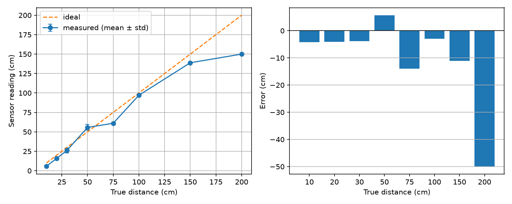

# Ultrasonic Sensor Characterization

Automated accuracy test of the ultrasonic distance sensor on my ELEGOO Smart Robot Car V4.0, done before relying on it for obstacle avoidance in the [delivery robot](../) project.

**Main result:** the sensor under-reads by about 4 cm at short range, has a repeatable −14 cm error at 75 cm, and never reports more than 150 cm.

## Setup

- Sensor: ultrasonic module on the robot's Arduino-compatible board
- Readings sent over serial (UART) to a Python script using `pyserial`
- Target placed at 8 measured reference distances: 10, 20, 30, 50, 75, 100, 150 and 200 cm
- 20 readings per distance (160 total)

## Results

Full data: [`data/ultrasonic_results.csv`](data/ultrasonic_results.csv) (error = mean reading − true distance)

| True distance (cm) | Mean (cm) | Std (cm) | Min–max (cm) | Error (cm) |
|---:|---:|---:|---:|---:|
| 10  | 5.75   | 0.44 | 5–6     | −4.25  |
| 20  | 15.85  | 1.93 | 14–22   | −4.15  |
| 30  | 26.15  | 3.15 | 22–31   | −3.85  |
| 50  | 55.70  | 3.79 | 50–62   | +5.70  |
| 75  | 61.05  | 1.50 | 59–65   | −13.95 |
| 100 | 97.05  | 0.22 | 97–98   | −2.95  |
| 150 | 138.85 | 0.49 | 138–140 | −11.15 |
| 200 | 150.00 | 0.00 | 150–150 | −50.00 |

## Findings

1. **Steady short-range offset:** about −4 cm from 10 to 30 cm. A calibration constant could correct it.
2. **150 cm ceiling:** all 20 readings at 200 cm were exactly 150 cm, so the output is capped at 150 cm in this setup.
3. **75 cm is wrong but repeatable:** −14 cm with only 1.5 cm spread. This points to the test setup (target size, angle or a closer reflection) rather than random noise.
4. **Noise depends on distance:** the spread is largest at 30–50 cm (std 3.2–3.8 cm) and smallest at 100 cm (0.2 cm).

## Next steps

- Repeat the 50–75 cm runs with a larger target held perpendicular to the sensor.
- Add a calibration offset in the firmware and re-run the test.
- Treat any reading of 150 cm as "out of range" in the obstacle-avoidance logic.

## Files

| File | Contents |
|---|---|
| `ultrasonic_test.py` | Python script that logs the readings over serial |
| `data/ultrasonic_results.csv` | Summary per distance: mean, std, min, max, error |
| `figures/ultrasonic_results.png` | Measured vs. true distance (left) and error per distance (right) |
